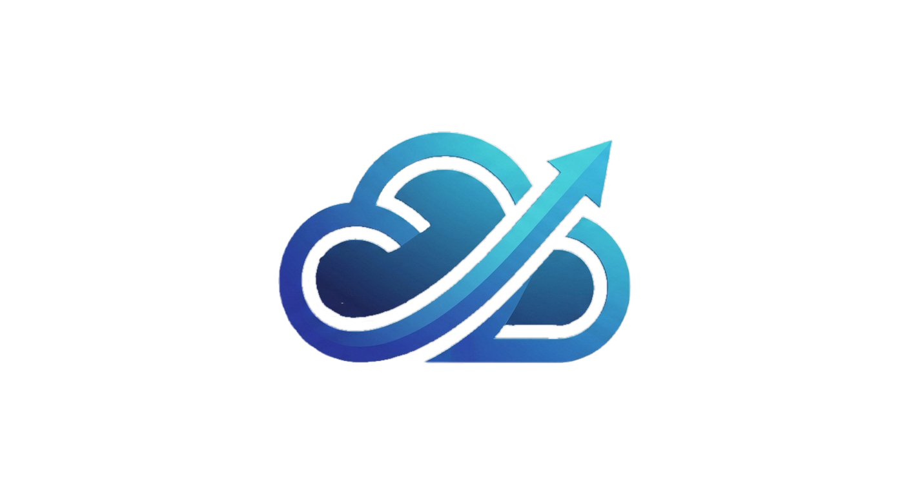

  <!-- Server Hero / Banner -->
  
  
    

  <!-- Aura Title -->
  <h1>⚡ ERA HOSTING & INFRASTRUCTURE</h1>
  
<b>High-Performance Game Server Hosting • Cloud Node Infrastructure • Developer Automation</b>

  <!-- Server Badges: Live Online Count + Fixed Total Member Badge -->
  

    
    
    
  

<!-- About Section -->
<h2>🔮 About Our Network</h2>

  Welcome to the official hub for our server hosting and cloud deployment ecosystem. We bring together system administrators, node engineers, game server hosts, and developers to build high-availability infrastructure and automated management systems.

<!-- Infrastructure Highlights -->
<h2>🛠️ Infrastructure & Tech Stack</h2>

<table>
  <tr>
    <td width="33%" align="center">
      <h3>🚀 Control Panels</h3>
        
      
Automated server provisioning, game server instances, and containerized Wings daemons.

    </td>
    <td width="33%" align="center">
      <h3>🌐 Reverse Proxy & SSL</h3>
        
      
Automated SSL certificate renewal, subdomains, and load balancing for high-traffic allocations.

    </td>
    <td width="34%" align="center">
      <h3>⚡ High Performance</h3>
        
      
Isolated environments, fast NVMe storage nodes, and custom API-driven server deployments.

    </td>
  </tr>
</table>

<!-- What We Offer -->
<h2>✨ Community Features</h2>

<table>
  <tr>
    <td width="50%">
      <h3>💻 Technical Support & Setup</h3>
      
Need help setting up game nodes, database connections, SSL proxies, or server daemons? Open a support ticket directly inside our Discord server.

    </td>
    <td width="50%">
      <h3>⚡ Node Status & Announcements</h3>
      
Get real-time updates on server maintenance, network upgrades, panel status, and automated backup schedules.

    </td>
  </tr>
</table>

<!-- Community Rules -->
<h2>📜 Server Guidelines</h2>

<table>
  <tr>
    <td>
      <ul>
        <li><b>Respect & Professionalism:</b> Maintain high standards when asking for or giving server administration help.</li>
        <li><b>Security First:</b> Never post API keys, root credentials, database passwords, or `.env` secrets in public channels.</li>
        <li><b>Use Dedicated Support Tickets:</b> Direct all hosting and server technical issues to the official support channel.</li>
        <li><b>No Malicious Activity:</b> Network abuse, unauthorized port scanning, or malicious scripts result in immediate ban.</li>
      </ul>
    </td>
  </tr>
</table>

 

<!-- Main Join Callout Banner -->
<blockquote align="center" style="background-color: #10002B; border-left: 5px solid #00F5D4;">
  🔮 <b>Need server hosting, panel deployment, or tech help?</b> 
  Join our Discord infrastructure hub and connect with our team!
    
  
</blockquote>

 

<!-- Footer -->

  Powered by High-Performance Cloud Infrastructure • Managed by Era Hosting Systems

